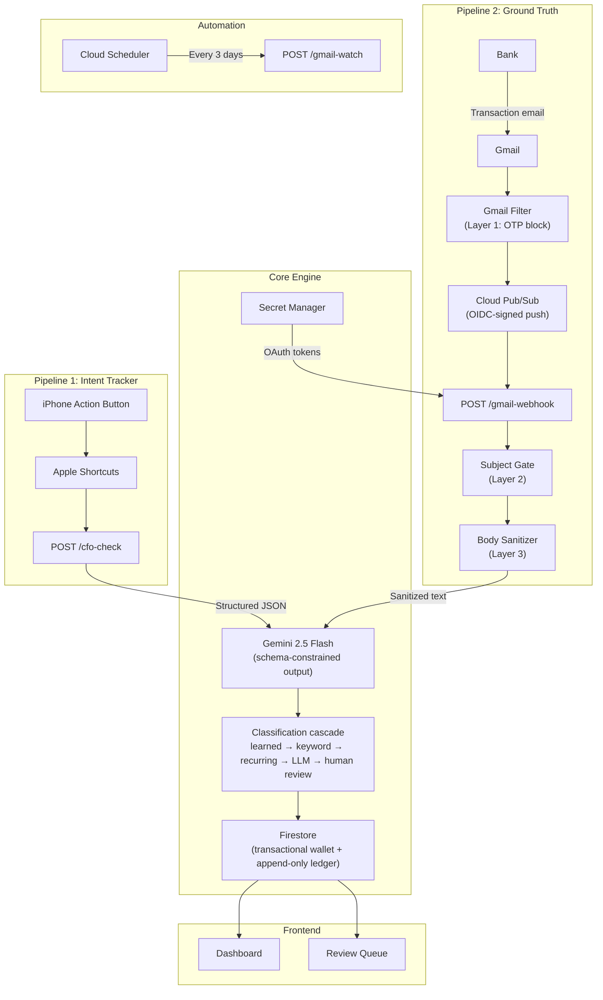

# AgentCFO — Autonomous Personal Finance Agent

[](https://github.com/sam0786-xyz/personal-cfo/actions/workflows/ci.yml)

An autonomous financial agent that tracks spending via voice commands **and** reconciles real bank transactions from Gmail — with a deterministic security firewall that guarantees OTPs never reach the LLM.

**Live**: [cfo.sam18.xyz](https://cfo.sam18.xyz) · FastAPI · Gemini · Firestore · Cloud Run

---

## Why this exists

Expense trackers rely on you typing numbers in. Bank apps know the truth but do nothing with it. AgentCFO bridges both:

1. **Pipeline 1 — Intent** (iPhone Action Button → voice → verdict): "Can I spend ₹300 on food?" The agent approves, rejects, or roasts, and updates the runway.
2. **Pipeline 2 — Ground truth** (bank email → Pub/Sub → webhook): when the actual bill turns out to be ₹340, the reconciliation pipeline corrects the balance automatically. No manual entry, ever.

## System architecture



## Engineering highlights

### 1. Three-layer OTP firewall (deterministic, tested adversarially)

The bank sends transaction alerts **and** OTPs from the same address, so a hard firewall sits in front of the LLM:

| Layer | Location | Mechanism |
|:---:|:---|:---|
| 1 | Gmail filter | Negative keyword match — OTP/PIN emails never get labeled (best-effort) |
| 2 | `app/security.py` | Subject gate: hard-blocks credential keywords, **default-denies** unknown subjects |
| 3 | `app/security.py` | Body sanitizer: redacts OTP-shaped digits *before* any text reaches Gemini |

Layers 2–3 are pure functions covered by adversarial tests (mixed "OTP for your UPI payment" subjects, credentials buried in transaction footers, etc.). Raw email bodies are never logged and never persisted — only the structured transaction survives.

### 2. Self-improving classification with a human in the loop

Every bank debit runs through a cascade (`app/classification.py`):

```
learned rules (user corrections, conf 0.98)
  → keyword rules (known merchants, conf 0.86; abstains on ambiguous brands like "uber" + "eats")
    → recurring-pattern inference (same payee ± 3% amount, seen ≥ 2×, conf 0.74)
      → LLM fallback (structured fields only, hard 0.78 confidence gate)
        → human review queue
```

Correcting one transaction in the review UI **creates a learned rule** and retroactively reclassifies every similar pending transaction — the classifier gets permanently smarter with each correction.

### 3. Concurrency-safe state

The Gmail webhook and the voice agent can fire at the same moment. All read-modify-write cycles run inside **Firestore transactions** (`app/state.py`), so neither path can clobber the other. The hot wallet document keeps only the most recent transactions (Firestore's 1 MiB document cap), while every transaction is mirrored to an append-only `cfo_ledger` collection.

### 4. Verified webhook, deterministic money math

- `/gmail-webhook` verifies the **Pub/Sub OIDC token** (audience + service-account identity) when configured — forged push envelopes are rejected with 401/403.
- The LLM only extracts intent and raw numbers. Every rupee of arithmetic — overdraft protection, debt ledger, balance overrides — happens in plain, unit-tested Python (`app/agent.py`).

## Repository structure

```
personal-cfo/
├── main.py                  # FastAPI entrypoint (middleware, routers, static mount)
├── app/
│   ├── config.py            # environment-driven settings (no personal constants in code)
│   ├── security.py          # private access, OTP firewall (L2+L3), Pub/Sub OIDC
│   ├── state.py             # transactional Firestore state + append-only ledger
│   ├── normalization.py     # payee/VPA/identity normalization
│   ├── classification.py    # rule cascade + human-in-the-loop learning
│   ├── agent.py             # CFO decision math (pure, unit-tested)
│   ├── llm.py               # Gemini structured-output calls (lazy client)
│   ├── gmail_pipeline.py    # Gmail history processing + reconciliation
│   └── routes/              # public, cfo, gmail endpoint groups
├── tests/                   # 111 tests: adversarial OTP cases, cascade, state, API auth
├── static/                  # vanilla JS dashboard (no build step)
├── scripts/gmail_auth.py    # one-time OAuth consent flow
└── .github/workflows/ci.yml # ruff + pytest on every push/PR
```

## Testing

```bash
uv sync
uv run pytest        # 111 tests
uv run ruff check .
```

The test suite covers the parts that must never regress: the OTP firewall (including adversarial subjects/bodies), the classification cascade and rule learning, transactional state mutation and ledger mirroring, agent decision math (overdraft, debts, multi-currency simulation), and endpoint auth boundaries.

## Configuration

All deployment-specific values are environment variables:

| Variable | Required | Purpose |
|:---|:---:|:---|
| `GEMINI_API_KEY` | ✅ | Gemini API access |
| `GCP_PROJECT` | ✅ | Firestore / Secret Manager / Pub/Sub project |
| `CFO_ACCESS_TOKEN` | ✅ | Private dashboard token (or `CFO_AUTH_DISABLED=true` locally) |
| `PUBSUB_AUDIENCE` | recommended | OIDC audience for webhook verification (your webhook URL) |
| `PUBSUB_SERVICE_ACCOUNT` | recommended | Pins the webhook caller identity |
| `BANK_ALERT_SENDER` | | Bank alert address (default `alerts@axis.bank.in`) |
| `CFO_DEFAULT_BALANCE` | | Starting runway balance (default `5000`) |
| `CFO_TARGET_DATE` | | Fixed runway end date (`YYYY-MM-DD`); defaults to a rolling 30-day horizon |
| `CFO_ALLOWED_ORIGINS` | | CORS origins, comma-separated |
| `GEMINI_MODEL` | | Model override (default `gemini-2.5-flash`) |

Seed values for the liquidity/synthetic-asset models (`CFO_LIQUID_SEED_PRINCIPAL`, `CFO_SEED_AXIS_EDGE_POINTS`, `CFO_SEED_GITHUB_CREDITS_USD`, `CFO_DEFAULT_API_BURN_USD`) all default to zero.

## Setup

### Local development

```bash
git clone https://github.com/sam0786-xyz/personal-cfo.git
cd personal-cfo
cp .env.example .env   # fill in GEMINI_API_KEY etc.
uv run uvicorn main:app --host 0.0.0.0 --port 8000 --reload
```

### Gmail ground-truth pipeline

<details>
<summary>Expand full GCP setup</summary>

#### 1. Enable APIs

```bash
gcloud services enable gmail.googleapis.com pubsub.googleapis.com secretmanager.googleapis.com cloudscheduler.googleapis.com
```

#### 2. Pub/Sub topic + authenticated push subscription

```bash
gcloud pubsub topics create gmail-bank-alerts

# Service account that signs push requests
gcloud iam service-accounts create pubsub-push

gcloud pubsub subscriptions create gmail-bank-alerts-push \
    --topic=gmail-bank-alerts \
    --push-endpoint=https://your-domain.com/gmail-webhook \
    --push-auth-service-account=pubsub-push@YOUR_PROJECT.iam.gserviceaccount.com

# Let Gmail publish to the topic
gcloud pubsub topics add-iam-policy-binding gmail-bank-alerts \
    --member="serviceAccount:gmail-api-push@system.gserviceaccount.com" \
    --role="roles/pubsub.publisher"
```

Then set on the service:

```bash
PUBSUB_AUDIENCE=https://your-domain.com/gmail-webhook
PUBSUB_SERVICE_ACCOUNT=pubsub-push@YOUR_PROJECT.iam.gserviceaccount.com
```

#### 3. OAuth credentials

1. Google Cloud Console → Credentials → Create OAuth Client → **Desktop app**
2. Save the JSON as `scripts/client_secret.json` (git-ignored)
3. Add your Gmail as a test user on the OAuth consent screen
4. Run `python scripts/gmail_auth.py` and store the printed secrets:

```bash
echo -n "REFRESH_TOKEN" | gcloud secrets create gmail-refresh-token --data-file=-
echo -n "CLIENT_ID"     | gcloud secrets create gmail-client-id --data-file=-
echo -n "CLIENT_SECRET" | gcloud secrets create gmail-client-secret --data-file=-
```

#### 4. Gmail filter (Layer 1)

Gmail Settings → Filters:
- **From**: your bank's alert address
- **Has**: `debited OR credited OR transaction OR paid OR received OR refund`
- **Doesn't have**: `OTP OR "One Time Password" OR verification OR PIN`
- **Action**: apply label `CFO-Transactions`

#### 5. Deploy & activate

```bash
gcloud run deploy personal-cfo --source . --region us-central1 --allow-unauthenticated --min-instances 1
curl -X POST https://your-domain.com/gmail-watch -H "Authorization: Bearer $CFO_ACCESS_TOKEN"
```

#### 6. Watch auto-renewal (Gmail watches expire after 7 days)

```bash
gcloud scheduler jobs create http renew-gmail-watch \
    --schedule="0 3 */3 * *" \
    --uri="https://your-domain.com/gmail-watch" \
    --http-method=POST \
    --headers="Authorization=Bearer $CFO_ACCESS_TOKEN"
```

</details>

### iPhone Action Button

| Shortcut block | Configuration |
|:---|:---|
| Ask for Input | Prompt: *"What do you want to buy?"* |
| Get Contents of URL | `POST https://your-domain.com/cfo-check` · Headers: `Content-Type: application/json`, `Authorization: Bearer <token>` · Body: `{"expense_text": "Provided Input"}` |
| Get Dictionary from | `Contents of URL` |
| Get Value for Key | `message` |
| Speak | Dictionary value |

Settings → Action Button → Shortcut → done: press, speak, get a verdict anywhere.

## API

| Method | Endpoint | Access | Description |
|:---:|:---|:---:|:---|
| `GET` | `/healthz` | public | Liveness probe |
| `GET` | `/public-profile` | public | Project metadata, zero personal finance data |
| `POST` | `/auth/session` | public | Exchanges the access token for an httpOnly session cookie |
| `GET` | `/cfo-state` | private | Balance, transactions, debts, rules, runway |
| `POST` | `/cfo-check` | private | Voice/text intent check → agent verdict |
| `POST` | `/cfo-reset` | private | Reset runway (keeps learned rules) |
| `GET` | `/transactions/review` | private | Ambiguous transactions awaiting classification |
| `POST` | `/transactions/{id}/classify` | private | Correct a category; learns a rule and reclassifies siblings |
| `GET/POST` | `/merchant-rules` | private | List / create classification rules |
| `POST` | `/gmail-webhook` | OIDC | Pub/Sub push receiver (3-layer firewall) |
| `POST` | `/gmail-watch` | private | Register/renew the Gmail watch |
| `GET` | `/gmail-status` | private | Bank-sync telemetry |

Private endpoints accept `Authorization: Bearer <token>`, `X-CFO-Token: <token>`, or the session cookie. Tokens in query strings are **not** accepted server-side (they leak into access logs); the dashboard's one-time `?token=` unlock exchanges it for a cookie via `POST /auth/session` and immediately strips it from the URL.

## Stack

Python 3.13 · FastAPI · Gemini 2.5 Flash (schema-constrained output) · Cloud Firestore · Gmail API + Pub/Sub · Secret Manager · Cloud Scheduler · Cloud Run · vanilla HTML/CSS/JS · uv · pytest + ruff + GitHub Actions

## License

Personal project by [Mohammad Sameer](https://github.com/sam0786-xyz).
